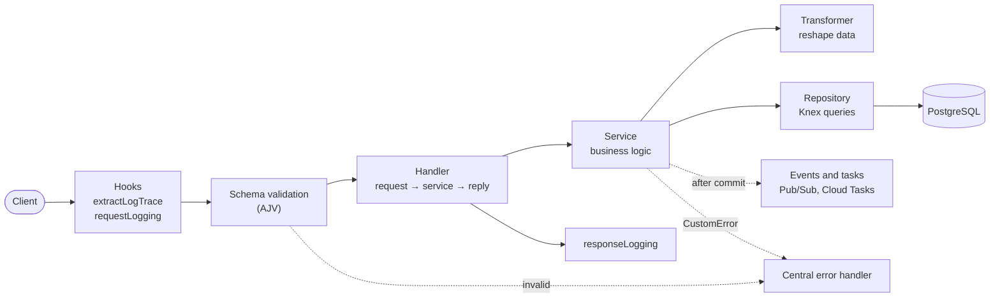

# Fastify Production-Ready Boilerplate

A clean, opinionated starting point for Node.js services built with **Fastify, Knex and PostgreSQL**.

Every new service starts from the same structure, so any engineer can open any service and know where
things live. It also ships with a [`CLAUDE.md`](./CLAUDE.md), so AI coding assistants write code that
follows the same style and standards as the rest of the project.

```
routes  →  handlers  →  services  →  repository  →  PostgreSQL
```

> **New here?** Start with [Quick start](#quick-start), then follow the [reading order](#reading-order-for-newcomers).

---

## Why this repo exists

Without a template, every new service quietly reinvents the same things: folder layout, error handling,
logging, tracing, database setup. This boilerplate solves them once:

- **Faster start:** a new service goes from an empty folder to a running endpoint on day one.
- **Consistency:** every service looks the same, so onboarding and code review get easier.
- **Fewer merge conflicts:** one file per endpoint means two people can work in the same module without touching the same file.
- **Production concerns by default:** validation, central error handling, trace logging, metrics, health check, CI.
- **AI-friendly:** a detailed `CLAUDE.md` describes every convention, so generated code matches your style.

## What is included

- Strict layering: routes, handlers, services, repository, transformers
- Centralised error handling with a `CustomError` class and database/validation error mappers
- Centralised request/response logging with trace headers and automatic redaction of passwords, tokens and OTPs
- HTTP client plugin with downstream error handling and metrics (`request`, `internalRequest`)
- Knex as a Fastify plugin, with a pagination helper and sample migrations
- Swagger docs, health check and Prometheus metrics
- Graceful shutdown: in-flight requests finish and connections close cleanly on SIGTERM / SIGINT
- Google Cloud plugins: Cloud Tasks, Pub/Sub, Cloud Storage, Datastore, Secret Manager
- Optional plugins you switch on when you need them (batching, Redis, CSV streaming, BigQuery)
- ESLint (airbnb-base) + Prettier, Husky git hooks, Jest with a coverage threshold
- GitHub Actions CI and a Dockerfile

---

## Quick start

**Requirements:** Node.js 20 or later, and a PostgreSQL database.

```bash
# 1. Install dependencies
npm install

# 2. Configure the environment
cp .env.example .env

# 3. Start PostgreSQL (skip if you already have one). This matches the values in .env.example
docker run --name fastify-boilerplate-db -p 5432:5432 \
  -e POSTGRES_PASSWORD=somepassword -e POSTGRES_DB=user -d postgres:16

# 4. Create the tables
npm run migrate

# 5. Run the service (default port 4444)
npm run start:dev
```

Try it:

```bash
curl -X POST http://localhost:4444/v1/users \
  -H "Content-Type: application/json" \
  -H "x-channel-id: WEB" \
  -d '{"full_name":"Asha Kumar Devi","phone_number":{"country_code":"+91","number":"9876543210"}}'
# → 201  {"user_id":"<uuid>"}
```

| URL | What |
| --- | --- |
| `http://localhost:4444/documentation` | Swagger UI, generated from the route schemas |
| `http://localhost:4444/health` | Health check |
| `http://localhost:4444/metrics` | Prometheus metrics |

---

## How a request flows



The rule: **no layer skipping.** A handler never talks to the database, and a route never holds logic.

| Layer | Responsibility |
| --- | --- |
| Routes | Register the endpoint: method, url, schema, handler |
| Handlers | Take values from the request, call one service, send the reply |
| Services | Business rules, transactions, publishing events |
| Repository | Knex queries only, no business logic and no data shaping |
| Transformers | Pure functions that reshape data between API and DB |
| Schemas | The API contract (request and response), also drives the Swagger docs |

---

## Folder structure

```
src/
├── index.js                      # builds the app: env, hooks, plugins, routes
└── app/
    ├── users/                    # sample module: copy it for your own domain
    │   ├── routes/index.js       # registers every endpoint of the module
    │   ├── handlers/             # 1 file per endpoint
    │   ├── schemas/              # 1 file per endpoint
    │   ├── services/             # 1 file per endpoint or business operation
    │   ├── repository/           # users.js (queries), downstreamCalls.js (HTTP calls)
    │   ├── transformers/         # API shape ⇄ DB rows
    │   └── commons/              # models.js (table/column names), constants.js
    ├── plugins/                  # Fastify plugins (tables below)
    ├── hooks/logging/            # trace + request/response logging
    ├── errorHandler/             # CustomError, central handler, error mappers
    ├── commons/                  # helpers, configs, constants, shared schemas
    └── utils/                    # DateTimeFormatter (timezone-aware)
config/                           # Knex configuration
migrations/                       # Knex migrations
samples/                          # Example entity definition (address.json) used by the sample prompt
sample_claude_prompt.md           # Ready-to-use prompt to build a new entity module with Claude
```

### Reading order for newcomers

Follow one request through the code. Each file is short.

1. [`src/index.js`](src/index.js): how the app is assembled
2. [`users/routes/index.js`](src/app/users/routes/index.js): the endpoint is registered
3. [`users/schemas/addUser.js`](src/app/users/schemas/addUser.js): the contract and validation
4. [`users/handlers/createUsers.js`](src/app/users/handlers/createUsers.js): thin glue
5. [`users/services/createUsers.js`](src/app/users/services/createUsers.js): the business logic
6. [`users/transformers/user.js`](src/app/users/transformers/user.js): data shaping
7. [`users/repository/users.js`](src/app/users/repository/users.js): the database query
8. [`errorHandler/`](src/app/errorHandler): how errors become responses
9. The tests next to each file, in `__tests__/` folders

---

## Plugins

### Registered by default (`src/index.js`)

| Decorator | What it does |
| --- | --- |
| `fastify.knex` | PostgreSQL via Knex, with `.paginate()` |
| `fastify.request` / `fastify.internalRequest` | HTTP calls to other services / to routes in this same app |
| `fastify.memCache` | In-memory cache |
| `fastify.readGcpSecret({ secretName })` | Reads the latest Secret Manager version, cached for an hour |
| `fastify.publishEvent(...)` / `fastify.parseEvent(...)` | Publish Pub/Sub events and parse incoming pushes |
| `fastify.createCloudTask(...)` | Create delayed, retried HTTP tasks |
| `fastify.cloudBucket` | Cloud Storage bucket (needs `CLOUD_BUCKET_NAME`, skipped otherwise) |
| `fastify.dataStore` | Datastore client |
| `fastify.convertJSONToCsv(...)` / `fastify.uploadCsvToBucket(...)` | JSON to CSV, and upload to the bucket |

The Google Cloud plugins need credentials and the matching variables in `.env`. Without them the app
still starts, and the plugins only fail when you actually call them.

### Optional (in `src/app/plugins`, not registered)

To use one, add `await fastify.register(require("./app/plugins/<name>"));` in `src/index.js`.

| Plugin | Decorator | What it does |
| --- | --- | --- |
| `batchProcessor` | `createBatchProcessor`, `createPubsubPullBatchProcessor` | Collect items and process them in batches by size or interval |
| `json2csvWriter` | `createCsvStreamWriter` | Stream large exports to CSV row by row |
| `redisCache` | `redisCache.setValue / getValue / deleteValues` | Redis cache helpers (set `REDIS_HOST`, `REDIS_PORT`, `REDIS_PASSWORD`) |
| `cloudBigQuery` | `bigQuery` | BigQuery client |

---

## Commands

| Command | Purpose |
| --- | --- |
| `npm run start:dev` | Run with nodemon and pretty logs |
| `npm run test:unit` | Jest unit tests with coverage (threshold 50%) |
| `npm run lint:fix` | ESLint + Prettier with auto-fix. Run it after every change |
| `npm run migrate` | Run pending migrations |
| `npm run migrate:make -- <name>` | Create a new migration |
| `npm run migrate:down` | Roll back the last migration |

Git hooks run automatically: lint before each commit, unit tests before each push.

## Environment variables

Copy `.env.example` to `.env`. The database variables and `PORT` are all you need locally.

| Variable | Purpose | Needed for |
| --- | --- | --- |
| `PORT` | HTTP port (default `4444`) | Always |
| `LOG_REQUEST_BODY_IN_RESPONSE` | Also log the (redacted) request body in the response log line (default `false`) | Optional |
| `SHUTDOWN_TIMEOUT_IN_MS` | Max time to wait for a graceful shutdown (default `25000`) | Optional |
| `DB_USER`, `DB_PASSWORD`, `DB_NAME`, `DB_HOST`, `DB_PORT` | PostgreSQL connection | Always |
| `DOWNSTREAM_SYSTEM_URI` | Base URL of another service | `downstreamCalls.js` |
| `GCP_PROJECT_ID`, `GCP_LOCATION` | Google Cloud project and region | Cloud plugins |
| `CLOUD_TASKS_DEFAULT_QUEUE` | Default Cloud Tasks queue | `createCloudTask` |
| `CLOUD_BUCKET_NAME` | Storage bucket | `cloudBucket`, `uploadCsvToBucket` |
| `DATASTORE_NAMESPACE` | Datastore namespace | `dataStore` |
| `REDIS_HOST`, `REDIS_PORT`, `REDIS_PASSWORD` | Redis connection | `redisCache` (optional plugin) |

---

## Adding an endpoint

Short version (the full recipe is in [`CLAUDE.md`](./CLAUDE.md)):

1. `schemas/<endpoint>.js`, then export it from `schemas/index.js`
2. `repository/<entity>.js`, add the query function
3. `services/<endpoint>.js`, the business logic
4. `handlers/<endpoint>.js`, then export it from `handlers/index.js`
5. Register the route in `routes/index.js`
6. Add tests, then run `npm run lint:fix` and `npm run test:unit`

**Practice exercise:** add `GET /v1/users/:userId` end to end: schema, repository query, service
(throw a 404 `CustomError` when the user does not exist), handler, route and tests.

---

## Working with Claude Code

This repo is set up so an AI assistant can extend it in your team's style.

- [`CLAUDE.md`](./CLAUDE.md) is read by [Claude Code](https://claude.com/claude-code) at the start of every session. It
  describes the architecture, the coding standards, the patterns (with the real code), and a
  "definition of done".
- It points to **reference files to copy** for each kind of code: a handler, a service, a repository, a test.
- It tells Claude to finish every task by running `npm run lint:fix` and `npm run test:unit`.

**Building a whole new entity?** Use [`sample_claude_prompt.md`](./sample_claude_prompt.md). You give it an
entity definition in JSON (see [`samples/address.json`](./samples/address.json)) and the list of APIs you
need, and Claude builds the migration, schemas, handlers, services, repository, tests and routes. It also
has short prompts for small changes such as adding a field or an endpoint.

For small, one-off requests, try prompts like:

```
Add GET /v1/users/:userId. The schema already exists. Follow CLAUDE.md.
```
```
Add a "customers" module with create and get endpoints, a migration, and tests.
```

Treat Claude's output like any teammate's: lint, the tests and code review still decide what ships.

---

## Logging

Logs are structured JSON on stdout (pretty-printed in development), so they work with any log collector.

- **One request id everywhere.** `reqId` is the gateway's `x-request-id`, or a generated UUID, and is
  attached to every log line of that request. The trace headers (`x-b3-traceid`, `x-user-journey-id`, ...)
  are logged as `log_trace` and forwarded to other services.
- **Secrets never reach the logs.** Bodies, query params and headers go through
  [`redactSensitiveData`](src/app/commons/redactor.js), which masks keys like `password`, `otp`, `token`
  and `x-api-key` at any depth. Add your own keys to `SENSITIVE_KEYS` in `src/app/commons/constants.js`.
  URLs are logged without their query string.
- **Request line:** the redacted body, query params and headers.
- **Response line:** the status code, the response time and the redacted **response body** (error responses
  included). The request body is not repeated there, unless you set `LOG_REQUEST_BODY_IN_RESPONSE=true`.
- `/health` and `/metrics` are not logged.

Response bodies can be large. If a service returns big payloads, lower the log level or drop the body
from `responseLogging` in `src/app/hooks/logging/index.js`.

## Graceful shutdown

When the process receives `SIGTERM` (container stop, Kubernetes pod termination) or `SIGINT` (Ctrl+C),
the service shuts down cleanly instead of dropping requests:

1. It stops accepting new connections and lets in-flight requests finish.
2. Fastify runs every plugin's `onClose` hook: the database pool and Google Cloud clients are closed, and
   items still waiting in a batch processor are flushed.
3. The process exits with code `0` (or `1` if closing failed).

If this takes longer than `SHUTDOWN_TIMEOUT_IN_MS` (default 25 seconds, safely under the 30 second
Kubernetes grace period) the process is forced to exit with code `1`. Uncaught exceptions and unhandled
promise rejections are logged and trigger the same shutdown with exit code `1`. A second signal while
shutting down is ignored.

The code is in [`src/app/commons/gracefulShutdown.js`](src/app/commons/gracefulShutdown.js) and is
registered in `start()` in `src/index.js`. In Docker, `entrypoint.sh` starts the app with `exec node`
so the signal reaches Node.

**Writing a plugin that opens a connection, client or timer?** Close it in an `onClose` hook:

```javascript
const db = knex({ ...options });
fastify.decorate("knex", db);
fastify.addHook("onClose", async () => {
  await db.destroy();
});
```

---

## Design decisions

| Decision | Why |
| --- | --- |
| One file per endpoint (handlers, schemas) | Developers working on different endpoints never edit the same file |
| Repositories contain no data shaping | Repos stay trivial to test. Transformers hold the mapping |
| Repo functions are called with `.call(fastify.knex, {...})` | The same repo function works with a normal connection or inside a transaction |
| Events are published after the transaction commits | A rolled-back write can never announce itself to other services |
| Errors bubble to one central handler | Every API returns errors in the same shape, and there is no scattered try/catch |
| Every function takes one destructured object | Call sites read clearly, and adding a parameter never breaks callers |
| Cleanup lives in plugin `onClose` hooks, not in the shutdown module | Each plugin closes what it opened, and Fastify closes them in reverse order after requests finish |
| Optional plugins are not registered by default | The base app stays small. Switch features on when you need them |

---

## Project status

This is a learning and starter project. Fork it, rename `users/` to your own domain, and delete what you do not need.

---

## License

[MIT](./LICENSE) © 2026 bittukr20
